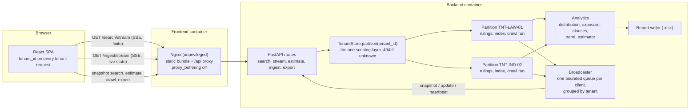

# LexStream On-Prem

[](https://github.com/d-gallardo-1/onprem-stream-indexer/actions/workflows/ci.yml)

**Multi-Tenant Regulatory & Case-Law Intelligence Engine: on-premises ingestion and
search that streams matching rulings as they are found and computes outcome analytics
live, with no external dependency.**

<!-- TODO: Insert 15s demo GIF here -->

> **Reference demo with invented data.** "LexStream On-Prem" is a fictional platform
> name. Every ruling, authority, statute, portal, judge, inspector, party and tenant in
> this repository is synthetic and was written for this demo; docket identifiers start
> with `SYN-` so no record can be read as a decision of a real body. Any resemblance to a
> real name is coincidental. The outcome estimator is illustrative and **is not legal
> advice**.

## The problem

Legal, compliance and industrial safety teams depend on cloud databases that they cannot
host internally and that return raw text. A team that must keep its research inside its
own network is left without search, and a team that has search still gets a list of
documents and no measure of how matters like theirs usually end.

This demo shows the alternative on a small scale: an engine that runs on your own
hardware, keeps each tenant's rulings in its own partition, streams matching rulings to
the browser one by one over Server-Sent Events, and recomputes outcome analytics for
every query.

## Key features

- **Data partitioning per tenant.** Two tenants, `TNT-LAW-01` (Vanguard Corporate
  Litigation LLP, commercial and labour rulings) and `TNT-IND-02` (NorthSea
  Infrastructure Compliance, industrial safety and machinery enforcement). Every read,
  stream, crawl and export goes through one scoping layer, `TenantStore.partition`, and
  an unknown tenant is a `404`. This is partitioning, not access control: see
  [Honest scope](#honest-scope).
- **Progressive search over SSE.** "Stream Search via SSE" delivers one matching ruling
  per event, shows how many milliseconds each one took to arrive, and ends with an
  `analytics_summary` event. The same search is also available as one ordinary request.
- **Full-text search without external services.** An in-memory inverted index with BM25
  ranking: every word must match, the last word also matches as a prefix, and titles
  weigh double. Filters: authority and outcome.
- **Outcome analytics recomputed for every query.** Outcome distribution in percent,
  total, median and highest financial exposure in GBP, ranking of the most cited
  clauses, and the resolution trend by authority. Money is integer or decimal
  arithmetic, never floating point.
- **A transparent estimator.** A smoothed empirical rate for a chosen authority, matter
  and outcome, shown with its sample size, a confidence label and every step of the
  calculation.
- **Ingestion simulator.** Start a simulated crawl and watch its stages arrive live
  (`CONNECTING_PORTAL`, `PARSING_DOCKETS`, `EXTRACTING_METADATA`, `INDEXED_NEW_RULING`)
  while new synthetic rulings enter the active tenant's index. Nothing is fetched: the
  portal is a name from a fixed list and the backend opens no network connection.
- **Excel report.** Download the results and analytics of the current tenant query as
  `.xlsx`. Cell text that starts with `=`, `+`, `-` or `@` is written as plain text.
- **Runs offline.** No CDN, no web fonts, no external API. CI scans the built bundle for
  any other origin.
- **Accessible status.** Every badge pairs colour with an icon and a text label, and
  animations respect the reduced-motion preference.

## Architecture



Two kinds of stream are used on purpose. The search stream is finite: one ruling per
event, then a summary. The state stream is long-lived and every event carries one
complete snapshot of one tenant's partition, so a client that connects late, or
reconnects after a drop, is consistent again after a single message.

More detail, including the security posture and what a real deployment would need:
[docs/ARCHITECTURE_AND_SECURITY.md](docs/ARCHITECTURE_AND_SECURITY.md).

## Quickstart

### With Docker

```bash
git clone https://github.com/d-gallardo-1/onprem-stream-indexer.git
cd onprem-stream-indexer
docker compose up --build
```

Then open <http://127.0.0.1:8082>.

### Without Docker

Requires Python 3.13+ and Node.js 20.19+. Python 3.13 is the version used by the
container image and by CI; the start scripts check it before doing anything else.

```powershell
# Windows. Unsigned scripts are blocked by default, so the policy is relaxed
# for this single run only.
powershell -ExecutionPolicy Bypass -File .\run_local.ps1
```

```bash
# Linux, macOS, WSL
./run_local.sh
```

Then open <http://127.0.0.1:5175>.

### Two-minute tour

1. **Live Search & Outcome Analytics** opens for `TNT-LAW-01`. Type `liquidated damages`
   and watch the list and the analytics panel follow the query.
2. Press **Stream Search via SSE**. The rulings arrive one by one, each with the
   milliseconds it took, and the analytics appear with the final event.
3. In the estimator choose *Halden Labour Review Board* and *Labour*. The estimate, its
   sample size and each step of the calculation are listed.
4. Change **Tenant** to `TNT-IND-02`. Every docket now starts with `SYN-IND-`, and the
   authority filter offers only that tenant's authorities.
5. Open **Ingestion Simulator**, pick a portal and press **Run simulated crawl**. The
   stages arrive live and three new rulings enter this tenant's index. Press it again
   while it runs from a second window to see the refusal.
6. Open **Tenant Partitioning & Export** to see the request path and download the
   `.xlsx` report of the query you typed.
7. Back in the simulator, press **Reset corpus**.

## UI layout

| Area | Content |
| --- | --- |
| Top bar | Platform name, "synthetic demo data" badge, tenant switcher, state-stream health, view tabs |
| Live Search & Outcome Analytics | Search and filter bar, stream button, ranked rulings with matched words marked and arrival time, outcome bars, exposure metrics, top clauses, trend by authority, estimator |
| Ingestion Simulator | Corpus counters, portal and size of the crawl, stage timeline, newest rulings, activity log, reset |
| Tenant Partitioning & Export Inspector | Partitioning notice, request path down to the two partitions, scoped routes, `.xlsx` report of the current query |

## API

Base path: `/api/v1`. The OpenAPI schema is served at `/api/v1/openapi.json`. Every route
is static; tenant routes take a required `tenant_id` query parameter (in the body for the
crawl).

| Method | Path | Purpose |
| --- | --- | --- |
| GET | `/health` | Liveness probe |
| GET | `/tenants` | Tenants with corpus counters, plus outcomes, matters and portal names |
| GET | `/search/snapshot?tenant_id=&q=&authority=&outcome=` | Results and analytics in one response |
| GET | `/search/stream?tenant_id=&q=&authority=&outcome=` | SSE: one `result` per ruling, then `analytics_summary` |
| GET | `/analytics/estimate?tenant_id=&authority=&matter=&outcome=` | Illustrative estimate with its steps |
| POST | `/ingest/simulate-crawl` | Body `{"tenant_id", "source_portal", "rulings"}`; `202` with a run id, `409` while one runs |
| GET | `/ingest/stream?tenant_id=` | SSE with full snapshots: crawl stages, new rulings, resets, `heartbeat` |
| GET | `/ingest/state?tenant_id=` | The same snapshot as one response |
| POST | `/ingest/reset` | Restore the default corpus of every tenant and notify clients |
| GET | `/export/analytics-xlsx?tenant_id=&q=&authority=&outcome=` | Report of the query as `.xlsx` |

Limits: `q` is at most 120 characters, a search stream sends at most 100 rulings
(`LEXSTREAM_MAX_STREAM_EVENTS`), a crawl adds 1 to 5 rulings and a tenant holds at most
60 crawled rulings. `source_portal` must be one of four fictional names; a URL is
rejected with `422`.

Watch a search arrive from a terminal:

```bash
curl -N "http://127.0.0.1:8082/api/v1/search/stream?tenant_id=TNT-LAW-01&q=costs"
```

## Repository layout

Orchestrator modules compose small, single-purpose modules. Source files are limited to
200 lines, and CI enforces it with `scripts/check_file_length.py`.

```text
backend/app/
  main.py              orchestrator: app factory, routers, 404 for unknown tenants
  engine.py            orchestrator: store, simulated crawls, live snapshots
  tenancy.py           TenantStore: the one tenant scoping layer
  partition.py         one tenant's rulings, index, crawl run and activity log
  search_service.py    snapshot search and the progressive result stream
  api/                 search, ingest and export routes; schemas
  index/               tokenizer, inverted index with BM25, filters, snippets
  analytics/           summary (distribution, exposure, clauses, trend), estimator
  workbook/            report writer and formula neutralisation
  streaming/           per-tenant broadcaster
  data/                tenants, default corpus per tenant, crawl sequence
  sse.py, config.py, models.py
backend/tests/         corpus, search, partitioning, analytics, crawl, search stream, export
frontend/src/
  App.tsx              orchestrator: one tenant at a time, one state stream for it
  components/          TopBar + search/, ingest/, partition/, shared/
  hooks/               useTenantStream, useSearchStream, useFetched, useAction
  lib/                 api, format, highlight
  test/                shared fixtures and a fake EventSource for tests
docs/ARCHITECTURE_AND_SECURITY.md
docker-compose.yml, run_local.ps1, run_local.sh
scripts/check_file_length.py     keeps every source file within 200 lines
scripts/check_bundle_offline.py  fails if the built bundle names another origin
.github/workflows/ci.yml         file length, tests, build, offline check, Docker smoke test
```

## Tests

```bash
cd backend
python -m venv .venv
.venv/bin/python -m pip install -r requirements-dev.txt   # Windows: .venv\Scripts\python
.venv/bin/python -m pytest -q
```

```bash
cd frontend
npm ci
npm test         # API client, both streams, tenant switch, the three views
npm run build    # type check + production build
python ../scripts/check_bundle_offline.py
```

The backend suite is split by subject: tenant partitioning (no endpoint, stream or export
returns a record of the other tenant), analytics arithmetic and the deterministic
estimator, the simulated crawl with its `409` and rejected portal values, reset, the
order of the search stream and its final summary, and the integrity of the `.xlsx`
report with formula neutralisation.

CI runs all of the above and also builds the Docker images, starts the stack and checks
the UI, both streams through Nginx, partitioning, a crawl round trip and the report.

## Configuration

| Variable | Default | Effect |
| --- | --- | --- |
| `LEXSTREAM_STREAM_DELAY_MS` | `120` | Pause between two rulings of a search stream; `0` in tests |
| `LEXSTREAM_CRAWL_STAGE_DELAY_MS` | `700` | Pause between two stages of a simulated crawl |
| `LEXSTREAM_MAX_STREAM_EVENTS` | `100` | Rulings one search stream may send (1 to 500) |
| `LEXSTREAM_BACKEND_URL` | `http://127.0.0.1:8002` | Backend used by the Vite dev proxy |

## Honest scope

- **Partitioning is not access control.** There is no authentication, so the tenant
  selector is not a login: any caller can name either tenant. What the demo shows is
  that, once a tenant is named, a request can only touch that tenant's partition. A real
  deployment must take the tenant from a verified identity, never from a parameter. The
  Docker setup binds to `127.0.0.1` for this reason.
- **The crawl is simulated.** No portal is contacted and no page is parsed. The stages
  are timed steps and the "found" rulings come from a deterministic generator. A
  production worker would drive a headless browser such as Playwright against sources
  the organisation is licensed to use; that is described in the docs, not implemented,
  and it is not a dependency of this repository.
- **The estimator is a teaching model.** It is a smoothed rate over a corpus of twenty
  invented rulings per deployment. It is noisy by construction, says so through its
  sample size, and describes no real court or regulator. It must not be used to assess
  a real matter.
- **State is in memory** and is lost on restart, including crawled rulings. Memory is
  bounded: 10 default and at most 60 crawled rulings per tenant.
- **One worker.** Two workers would hold two different sets of partitions.
- **Search is simple on purpose.** No stemming, no synonyms, no phrase queries, English
  stop words only.
- **Reset is global and unauthenticated**, like every other command.

## Contact

Built by Dario Gallardo. Questions, feedback and collaboration are welcome:

- LinkedIn: [linkedin.com/in/dario-gallardo-0b1654304](https://www.linkedin.com/in/dario-gallardo-0b1654304/)
- Bugs and suggestions: [open an issue](https://github.com/d-gallardo-1/onprem-stream-indexer/issues)

## License

[MIT](LICENSE)
